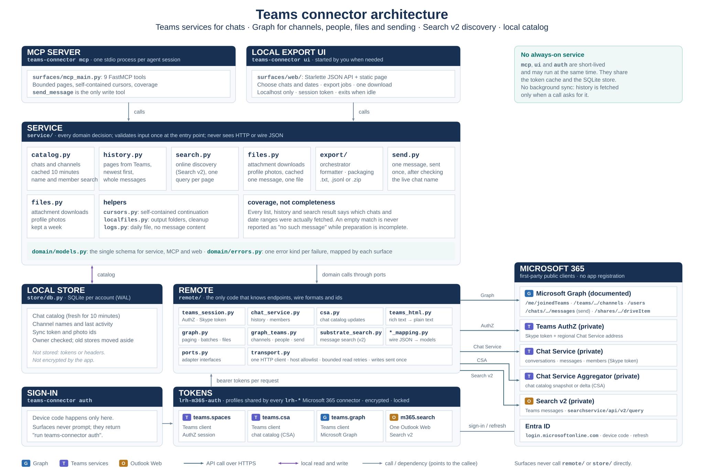

# Teams Connector — Architecture

**Inputs:** [Requirements](requirements.md) · [API research](api-research.md) · **Open work:** [roadmap](roadmap.md)

The repository contains one current application: the `teams-connector` CLI and the
`teams_connector` Python package. MCP and the loopback web UI call the same domain services.



The classes and who calls whom, in more detail: [code map](diagrams/code-map.svg). The diagrams give the
overview; this document records the rules and contracts they cannot show.

## Code structure

| Layer | Responsibility |
|---|---|
| `src/teams_connector/__main__.py` | Canonical CLI (`teams-connector`) for shared sign-in, profile status, MCP, UI, and account-bound archive backup. Loads MCP and web dependencies only for those commands. |
| `surfaces/mcp_main.py` | Typed MCP tools over the service layer. Keeps stdio free of logs; `send_message` is the only Teams write tool. |
| `surfaces/web/` | Starlette app, static local export page, and loopback UI launcher. Uses a per-run session token, Host validation, and an idle timeout. |
| `service/` | Domain behavior for the catalog, message history, local matching, archive sync, exports, attachment downloads, profile photos, and sending. MCP and UI share these operations. |
| `remote/ports.py` | Interfaces used by services; service code does not depend on concrete HTTP adapters. |
| `remote/transport.py` | The only general HTTP client. Applies the allowlist, authentication, one-time 401 renewal, bounded idempotent retries, response limits, error mapping, and credential-free download redirects. |
| `remote/chat_service.py`, `remote/csa.py` | Private Teams service adapters for chat catalog/history/rosters and CSA updates. Their endpoints are undocumented and described as private in the research record. |
| `remote/graph.py`, `remote/graph_teams.py` | Microsoft Graph paging, batching, channel history, people/photos, file download, and the explicitly authorized message-send request. |
| `remote/*_mapping.py` and `remote/teams_html.py` | Convert wire responses into domain records and readable message text. Wire-format field names remain inside this layer. |
| `store/db.py` | Account-bound SQLite archive for the catalog, message history, participant rosters, and resumable sync progress. Contains no tokens or authorization headers. |
| `service/export/` | Text/JSONL formatting and safe output packaging. Exports stream from the archive, use exclusive temporary paths, and publish only after completion. |
| `service/localfiles.py` | Per-user output directories, retention cleanup, and collision-safe file creation. |
| `src/teams_connector/config.py` | Product CLI/data names and fixed public service URLs. Tenant authority, client IDs, token profiles, scopes, and shared-cache configuration live in `lrh-m365-auth`. |

The service layer receives adapters through the ports and is responsible for decisions and coverage.
Only the `remote/` layer knows Microsoft request bodies, headers, endpoints, paging links, and IDs.
The two surfaces validate external inputs before calling services; internal service routines rely
on their typed contracts.

Shared rules live once in the service and domain layers: conversation lookup, history selection,
export packaging and domain errors. Each surface keeps its own protocol work: the UI parses calendar
dates with the browser's UTC offset while MCP takes ISO 8601 timestamps; the UI guards Host headers
and a session token while MCP runs over stdio; the UI streams downloads while MCP returns local
paths; each maps domain errors to its own responses.

## Authentication and account boundaries

The shared `lrh-m365-auth` package supplies six named profiles shared by the three connectors:

| Profile | Used for |
|---|---|
| `teams.spaces` | Teams AuthZ/session exchange and Teams account identity. |
| `teams.csa` | Teams conversation catalog updates. |
| `teams.graph` | Graph teams, channels, people, and message operations. |
| `outlook.graph` | Outlook and validated OneDrive/SharePoint Graph capabilities. |
| `outlook.api` | Outlook Web operations owned by the Outlook connector. |
| `m365.search` | Search v2 for online Teams message discovery (and Outlook calendar search). |

The auth package owns MSAL state and the encrypted cross-process cache; it does not issue Teams or
Graph requests or exchange a Teams Skype token. Each connector keeps its product wire logic. An
explicit `auth` command from any connector bootstraps the common profile catalog, silently reuses
accepted profiles, and requests approval only when needed. Microsoft can ask for more than one
approval because the public clients and resource audiences differ.

One active Microsoft account is bound to the shared cache. Signing out and choosing another account
invalidates the shared profile state; long-running processes refresh their account binding on the
next token request. The Teams composition root checks the current identity at each service boundary
and builds an account-specific Store before serving account data. Offline status reports cached
OAuth client credentials separately from resource-specific access-token expiry; profiles sharing a
client can show the same credential state. Neither fact proves that a token can be acquired or that a
particular service or conversation will authorize the operation.

MCP, ordinary UI use, and status reads do not launch interactive login. Encrypted storage is
mandatory by default. The explicitly selected `--unsecure` mode uses a separate plaintext development
cache and must never be used as an implicit fallback.

## Requests, caching, and storage

The MCP server is a stdio process scoped to one client session. It performs no network calls until a
tool needs them. The UI runs only while explicitly started, binds to loopback, and closes on exit,
Ctrl+C, or its idle timeout. There is no recurring sync task, watcher, remote listener, or background
refresh process.

The chat catalog may be reused for up to ten minutes. Explicit refresh waits for the remote read.
History, participant rosters, and sync continuation state are persisted in SQLite. Searches fetch
the requested conversation/date scope in bounded calls and match the stored messages; `coverage`
explains which chats/ranges were actually fetched. This is not a remote global-keyword search.

The database lives below `<Teams data directory>/accounts/<account fingerprint>/teams.sqlite3`.
Owner metadata is verified on open; an account mismatch raises an error instead of reusing another
account's archive. SQLite WAL, busy timeouts, per-operation connections, and short transactions allow
the MCP and UI processes to use the same account store. The local archive is not encrypted by this
application. Message content is retained until the user removes the archive.

The message archive is being removed (decided 2026-10-14; [requirements §6](requirements.md#6-local-data-decided-2026-10-14),
roadmap D2). Only a small chat-list cache without message text will remain.

Exports and downloaded attachments are written below the Teams data directory, are given exclusive
filenames, and are removed after seven days when their output directory is next used. A failed or
cancelled export does not publish a partial result. The `backup` command uses SQLite's online backup
API and refuses to replace an existing destination unless `--overwrite` is explicit.

## HTTP and safety rules

The shared transport accepts HTTPS only and checks Graph and Teams hosts before sending credentials.
Regional Chat Service URLs come from the Teams AuthZ response and are checked against the Teams
domain allowlist. Read-only requests retry a bounded set of transient failures; the retry delay
honors `Retry-After` within its limit. Writes are not retried. A request whose result is ambiguous
raises `WriteOutcomeUnknown` so an agent can inspect the target before taking another action.

Graph file-download endpoints can return a preauthenticated SharePoint redirect. The transport
allows one HTTPS redirect to a SharePoint download host and does not forward the Graph bearer token
to that host. Downloads have caller-supplied byte limits and are streamed to temporary files before
publication. URLs, query strings, bodies, authorization headers, message content, and search terms
are omitted from operational logs; credential-like values are redacted as another safeguard.

The local UI rejects non-local Host headers and requires a random per-process token on API calls.
It uses a restrictive Content Security Policy and renders message content as text. The browser page
does not receive a Microsoft token.

## Search behavior and boundaries

`search_remote_messages` uses the shared Microsoft Search profile and the standalone Search v2
endpoint for online Teams message discovery. It returns bounded message pointers, previews, timestamps,
and conversation candidates; a conversation ID is attached only on an exact local-catalog match. The
pointer (`search_message_id`) equals the history API's message ID (verified 2026-10-14), but the tool
does not yet return it as `message_id` (roadmap P2.2d). Search v2 matches words, word prefixes and
quoted phrases, not the middle of words. Agents decide whether to fetch surrounding history with
`get_messages` or request another search page.

`search_messages` remains a separate local archive workflow. The caller chooses the conversation
scope, inclusive date range, and matching mode. The connector retrieves that range in bounded page
requests, stores it, matches messages locally, and returns explicit preparation and per-conversation
coverage. Neither message search discovers transcript or recap text, and there is no stable history
page number for a search hit.

Reverse-engineered endpoint shapes, source audits, and dated confidence notes are maintained in
[Teams API research](api-research.md). Treat successful browser behavior as evidence, not a
guarantee that the connector's app-owned token has the same access.

## Logging

The MCP process logs to a per-process daily-rotated file, keeping stdout for protocol traffic. Log
files are under the Teams data directory's `logs/` folder. UI logs also go to stdout. Operational
records include timing, status, and counts, not message bodies, search text, chat names, IDs, tokens,
or authorization headers. Set `TEAMS_CONNECTOR_LOG_LEVEL=DEBUG` to enable safe request and paging
diagnostics.

## MCP tools

### Find conversations and read messages

1. Call `list_chats` to browse current chats and channels. It returns up to 50 items by default,
   supports `limit` up to 200 and opaque continuation `cursor`, and can filter by `kind`. A cached
   catalog up to ten minutes old may answer unless `refresh=true`. `coverage.source` identifies
   whether the response used the local catalog or a refresh.
2. Use `search_chats` to match a conversation name or participant name. Participant names are
   available only after rosters have been indexed by `sync_archive`; read roster coverage.
3. Call `get_messages` with the selected `conversation_id`. Pages are newest first; records within
   each page are oldest first. `since` and `until` are inclusive. `message_limit` caps the latest
   matching messages, while `page_size` controls the returned page. Follow `cursor` to get older
   messages. If a message body has `text_truncated=true`, call `get_message_content` with its ID and
   the indicated continuation offset.

Example arguments for a bounded history read:

```json
{
  "conversation_id": "19:sample@thread.v2",
  "since": "2026-08-01T00:00:00Z",
  "until": "2026-08-31T23:59:59Z",
  "page_size": 25,
  "message_limit": 100
}
```

### Online Teams message discovery

`search_remote_messages` calls Microsoft Search v2 for Teams messages and returns one bounded page
(up to 25 hits; query text is limited to 512 characters).
It does not fill or scan the local archive. Each hit preserves the Search v2 message reference,
preview, sender, subject, timestamp, and conversation identity candidates supplied by the service.
The connector sets `conversation_id` only when a candidate exactly equals a known local catalog ID.
The hit's `search_message_id` is the same id `get_messages` returns as `message_id` (verified
2026-10-14). An empty search is currently reported as unconfirmed (roadmap B2).

When a hit has a `conversation_id` and `sent_at`, use `get_messages` with a bounded `since`/`until`
window around that timestamp to inspect surrounding context. History paging has no stable page number
for a search result. The agent decides whether to expand context or follow the search `cursor`; each
cursor requests only the next bounded Search v2 page. This operation does not discover recap or
transcript text. Those capabilities remain separate and unresolved.

### Search message text in a chosen scope

`search_messages` performs local matching. Choose exactly one scope: a list of
`conversation_ids` or `all_chats=true`, and provide both `since` and `until`. Each call fetches a
bounded number of remote pages into the archive before matching. If `coverage.preparation_complete`
is false, repeat with the returned `cursor`. The response distinguishes incomplete retrieval from
an empty match set and reports date coverage per conversation.

The modes are `exact`, `substring` (the default), and `all_terms`. `exact` compares the whole
message text, not a phrase within it (roadmap B1). Matching is case-insensitive,
accents remain significant, and SQL wildcard characters in a query are literal. Local archive
messages remain searchable after the remote service no longer returns them. This tool is not the
Teams Web global-search endpoint and does not return a page number or a jump-to-message handle.

Example search across one explicitly selected conversation and month:

```json
{
  "query": "budget review",
  "since": "2026-08-01T00:00:00Z",
  "until": "2026-08-31T23:59:59Z",
  "conversation_ids": ["19:sample@thread.v2"],
  "match_mode": "substring",
  "limit": 20,
  "max_pages": 10
}
```

### Sync, archive status, and exports

`sync_archive` explicitly fetches history and optional participant rosters in bounded resumable
batches. It does not run in the background. Repeated calls rotate fairly across chats and resume
each chat's saved continuation. `archive_status` reports total messages and the history, date-range,
and roster coverage for the selected conversations.

`export_chats` writes `.txt` by default or `.jsonl` when requested. Set `include_attachments=false`
to omit linked files. A single conversation with selected attachments returns a ZIP containing a
folder with the text export and files; without selected attachments it returns the plain text/JSONL
file. Multiple conversations always return an outer ZIP of each conversation's artifact, so chats
with attachments have an inner ZIP and chats without them have a plain file. Apply inclusive date
bounds and a latest-
message limit per chat. The result contains a local path; use the MCP client's local file-reading
capability to inspect it. Exporting fetches the selected remote history first and can take time for a
large selection.

`download_attachment` saves a file linked from a message already in the archive. Pass `name` when
the message has multiple downloadable files. Downloads stream to an exclusive local file and have
a size bound; the tool returns the saved path. General OneDrive and SharePoint discovery belongs to
the SharePoint connector. Email attachments belong to Outlook.

### Send a message

`send_message` is the only Teams write tool. The user must explicitly authorize both the recipient
and exact message content. Pass the current conversation name from `list_chats` as
`expected_chat_name`; the service refreshes only that recipient (a chat's delta, or a channel's name from
its team), then checks the name before sending. HTML characters are escaped and the
message is attempted once. A network failure after the request may leave the result uncertain, so
inspect the conversation before deciding whether another send is needed. A search result or request
to analyze a conversation does not authorize a send.
